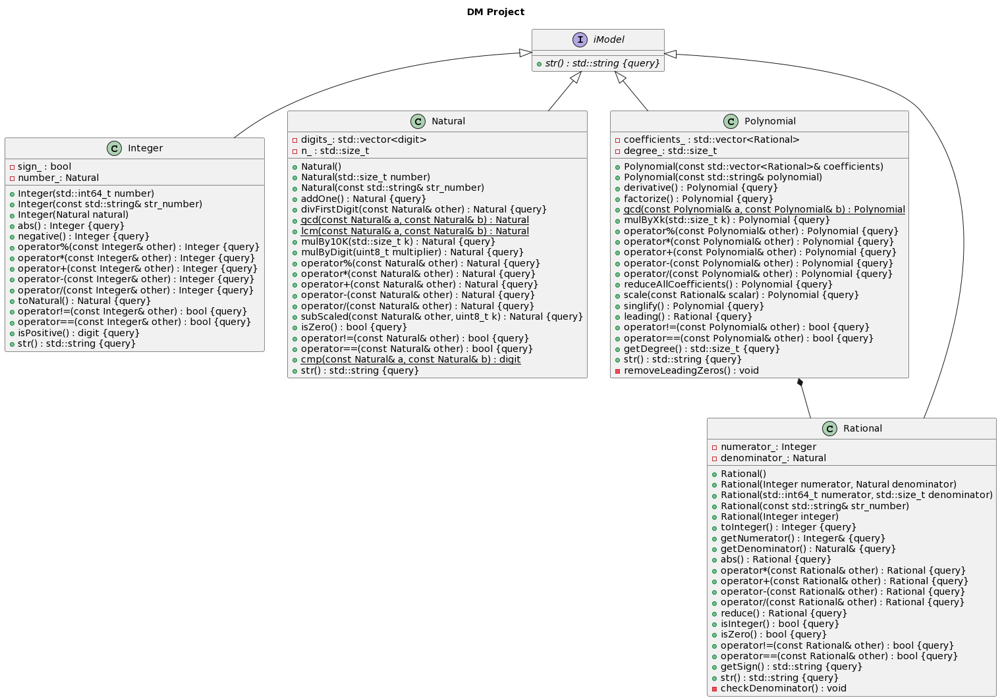

# Long_Number_Arithmetic_Project

## Временная инструкция по установке (до сдачи коллоквиума)
1) Заходите на ветку UI, скачиваете как архив
2) Распаковываете архив
3) В зависимости от ОС запускаете: (сборка под мак пока под вопросом)
   * Windows:  build-windows/release/DM.exe
   * Linux:    build-linux/DM
  

